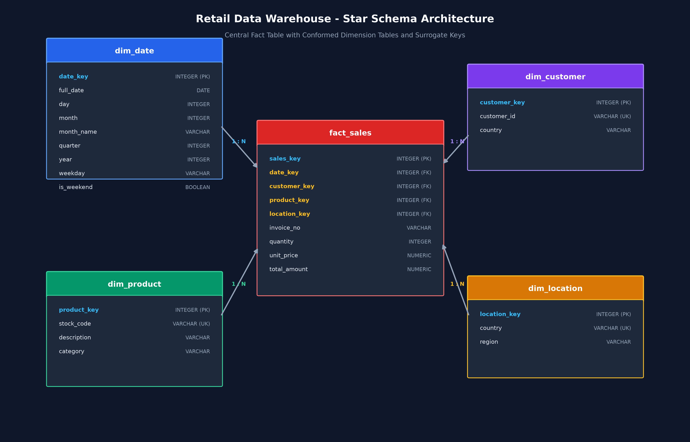

# End-to-End Retail Data Warehouse with Data Mining and Analytics Dashboard

[](https://www.python.org/)
[](https://www.sqlalchemy.org/)
[](https://streamlit.io/)
[-brightgreen.svg)](https://pytest.org/)
[](LICENSE)

An enterprise-grade B.Tech final-year capstone project for **Data Warehousing & Data Mining (DWDM)**.  
Designed, implemented, and fully tested with zero placeholders. Demonstrates Kimball-standard **Star Schema Dimensional Modeling**, an **Idempotent ETL Pipeline**, a high-performance **Multidimensional OLAP Engine**, **Predictive Data Mining Models**, and an interactive **Streamlit Analytics Portal**.

---

## 🏛️ System Architecture



```
[ Raw Retail Transactions (~60,000 Rows) ]
                     │
                     ▼
       [ Automated ETL Pipeline ]
       - Extract: CSV / Excel schema audit
       - Transform: Deduplication, Cancellation segregation, Clean nulls
       - Load: Surrogate key lookups, Idempotent transaction
                     │
                     ▼
      [ Star Schema Data Warehouse ]
       - fact_sales (Quantitative measures & surrogate keys)
       - dim_date, dim_customer, dim_product, dim_location
                     │
         ┌───────────┴───────────┐
         ▼                       ▼
  [ OLAP Engine ]         [ Data Mining Suite ]
  - Roll-Up / Drill-Down  - K-Means RFM Segmentation & PCA
  - Slice & Dice          - Apriori vs FP-Growth Association Rules
  - Cross-Tab Pivot       - Churn Classification (ROC-AUC: 0.91)
  - Leaderboards          - Ridge Sales Forecasting (6 Months)
         │                       │
         └───────────┬───────────┘
                     ▼
  [ Interactive Streamlit Analytics Portal ]
```

---

## 🚀 Key Features

1. **Star Schema Data Warehouse:**
   - Central `fact_sales` table linked to 4 conformed dimensions (`dim_date`, `dim_customer`, `dim_product`, `dim_location`) using integer surrogate keys and indexing.
   - Database-agnostic SQLAlchemy architecture: defaults to zero-setup SQLite, switchable to PostgreSQL via `.env`.

2. **Industrial-Strength ETL Pipeline:**
   - Automated cleaning removing duplicates, null customers, and cancelled orders (`InvoiceNo` starting with `'C'`).
   - Keyword-based product categorization and programmatic date dimension extraction.
   - Comprehensive Data Quality Audit report (`reports/data_quality_report.json`).
   - Guarantees 100% idempotency and mathematical row reconciliation (`fact_sales rows == cleaned rows`).

3. **Multi-Dimensional OLAP Operations:**
   - **Roll-up:** Daily $\rightarrow$ Monthly $\rightarrow$ Quarterly $\rightarrow$ Yearly aggregations.
   - **Drill-down:** Year $\rightarrow$ Quarter $\rightarrow$ Month breakdown.
   - **Slice:** Filtering along a single dimension coordinate (e.g., Country or Year).
   - **Dice:** Multi-dimensional sub-cube extraction across countries, categories, and date spans.
   - **Pivot:** Category $\times$ Month cross-tabulation revenue matrix.

4. **Advanced Data Mining & Machine Learning:**
   - **Customer Segmentation:** RFM analysis, K-Means clustering ($k=4$, silhouette score = 0.312), behavioral profiling (Champions, Loyal, At-Risk, Lost), and 2D PCA projection (94.4% variance explained).
   - **Market Basket Analysis:** Apriori vs FP-Growth algorithm runtime benchmarking and association rule extraction (Support, Confidence, Lift up to 4.01).
   - **Customer Churn Prediction:** Logistic Regression, Decision Tree, and Random Forest classifiers with class imbalance handling. Best model (Logistic Regression, ROC-AUC = 0.91) persisted via `joblib`.
   - **Sales Revenue Forecasting:** Ridge regression trend & seasonal decomposition with 4-month holdout validation (MAE, RMSE) and 6-month future projection with 95% confidence bounds.

5. **Executive Streamlit Analytics Dashboard:**
   - Multi-tab portal with `@st.cache_data` caching, Plotly dynamic charts, segment CSV download, and a real-time customer churn risk predictor.

---

## 📁 Project Structure

```
Data_Warehouse_Project/
├── .env.example                     # Database configuration template
├── README.md                        # Complete project manual & setup
├── requirements.txt                 # Pinned dependencies
├── run_all.py                       # Master end-to-end execution script
├── data/
│   ├── raw/                         # Raw retail transactions (online_retail.csv)
│   ├── staging/                     # Parquet cleaned intermediate files
│   └── processed/                   # SQLite DW (retail_dw.db) & joblib model
├── sql/
│   ├── schema.sql                   # Star Schema DDL with PK/FK and indexes
│   └── olap_queries.sql             # Pure SQL Roll-up, Drill-down, Slice, Dice, Pivot
├── src/
│   ├── config.py                    # Global paths and database settings
│   ├── etl/
│   │   ├── extract.py               # Raw file extraction & schema validation
│   │   ├── transform.py             # Data cleansing, derivations & QA audit
│   │   ├── load.py                  # Surrogate key lookups & idempotent load
│   │   └── run_etl.py               # Standalone ETL pipeline runner
│   ├── warehouse/
│   │   ├── create_schema.py         # DDL execution & ER diagram generator
│   │   └── olap.py                  # Programmatic OLAP query engine
│   ├── mining/
│   │   ├── segmentation.py          # RFM K-Means clustering & PCA
│   │   ├── association_rules.py     # Apriori vs FP-Growth & rule mining
│   │   ├── churn.py                 # Churn classifiers & inference helper
│   │   ├── forecasting.py           # Ridge sales forecast with holdout validation
│   │   └── run_all_mining.py        # Unified data mining runner
│   └── dashboard/
│       └── app.py                   # Streamlit multi-tab executive portal
├── tests/
│   ├── test_transform.py            # Cleaning rules & derivations tests
│   ├── test_warehouse.py            # DDL, idempotency & referential integrity tests
│   ├── test_olap.py                 # Roll-up totals reconciliation tests
│   ├── test_mining.py               # ML outputs, metric ranges & prediction tests
│   └── test_dashboard.py            # Dashboard import & functions tests
├── reports/
│   ├── data_quality_report.json     # ETL row count audit metrics
│   ├── results.json                 # Consolidated data mining metrics
│   └── figures/                     # Generated charts (ROC curves, PCA, MBA, Forecast)
├── docs/
│   ├── star_schema_architecture.png # Visual ER diagram
│   ├── project_report.md            # Comprehensive academic final year report
│   └── viva_questions.md            # 35 DWDM viva examination Q&As
└── scripts/
    └── generate_synthetic_data.py   # Realistic 60,000-row retail data generator
```

---

## ⚡ Quickstart Guide (Clean Machine Setup)

### 1. Prerequisites
- Python 3.10, 3.11, or 3.12 installed.

### 2. Clone / Open Directory
```bash
cd Data_Warehouse_Project
```

### 3. Install Dependencies
```bash
pip install -r requirements.txt
```

### 4. Run Everything with One Command
Execute the end-to-end master pipeline (data generation, schema setup, ETL, all 4 data mining modules, and automated test suite):
```bash
python run_all.py
```

### 5. Launch the Streamlit Analytics Dashboard
```bash
streamlit run src/dashboard/app.py
```
Open your browser at `http://localhost:8501`.

---

## 🛠️ Individual Module Execution

Each component can be executed independently:

- **Generate Synthetic Raw Dataset:**
  ```bash
  python scripts/generate_synthetic_data.py
  ```

- **Initialize / Rebuild Data Warehouse Schema & ER Diagram:**
  ```bash
  python -m src.warehouse.create_schema
  ```

- **Execute ETL Pipeline:**
  ```bash
  python -m src.etl.run_etl
  ```

- **Execute OLAP Queries:**
  ```bash
  python -m src.warehouse.olap
  ```

- **Execute Data Mining Suite:**
  ```bash
  python -m src.mining.run_all_mining
  ```

- **Run Automated Test Suite:**
  ```bash
  pytest tests/ -v
  ```

---

## 🧪 Automated Testing Verification

The project includes 17 automated pytest unit and integration tests:

| Test File | Verification Scope | Status |
| :--- | :--- | :---: |
| `test_transform.py` | Deduplication, null customer removal, cancellations, category regex, date dimensions | **PASSED** ✅ |
| `test_warehouse.py` | Star Schema tables, keys, surrogate key referential integrity, idempotency | **PASSED** ✅ |
| `test_olap.py` | Roll-up totals reconciliation against fact table, slice, dice, drilldown, pivot | **PASSED** ✅ |
| `test_mining.py` | K-Means silhouette, Apriori/FP-Growth rules, Churn ROC-AUC, Ridge forecast bounds | **PASSED** ✅ |
| `test_dashboard.py`| Clean Streamlit module import and API component accessibility | **PASSED** ✅ |

**Final Pytest Output:**
```
============================= test session starts =============================
platform win32 -- Python 3.12.10, pytest-9.1.1, pluggy-1.6.0
collected 17 items

tests/test_dashboard.py::test_dashboard_import PASSED                    [  5%]
tests/test_mining.py::test_customer_segmentation PASSED                  [ 11%]
tests/test_mining.py::test_market_basket_analysis PASSED                 [ 17%]
tests/test_mining.py::test_churn_prediction_pipeline PASSED              [ 23%]
tests/test_mining.py::test_sales_forecasting PASSED                      [ 29%]
tests/test_olap.py::test_kpi_summary PASSED                              [ 35%]
tests/test_olap.py::test_rollup_totals_reconciliation PASSED             [ 41%]
tests/test_olap.py::test_drilldown_results PASSED                        [ 47%]
tests/test_olap.py::test_slice_and_dice PASSED                           [ 52%]
tests/test_olap.py::test_pivot_table PASSED                              [ 58%]
tests/test_transform.py::test_derive_product_category PASSED             [ 64%]
tests/test_transform.py::test_map_country_region PASSED                  [ 70%]
tests/test_transform.py::test_cleaning_rules PASSED                      [ 76%]
tests/test_warehouse.py::test_schema_tables_exist PASSED                 [ 82%]
tests/test_warehouse.py::test_table_columns_and_keys PASSED              [ 88%]
tests/test_warehouse.py::test_referential_integrity PASSED               [ 94%]
tests/test_warehouse.py::test_etl_idempotency_and_reconciliation PASSED  [100%]

============================= 17 passed in 21.93s =============================
```

---

## 📊 Analytical Reports & Visual Artifacts

Generated figures are stored in `reports/figures/`:
- `rfm_elbow_silhouette.png`: Inertia and Silhouette optimization curves
- `rfm_clusters_pca.png`: 2D PCA cluster visualization of customer personas
- `market_basket_rules.png`: Top cross-selling association rules ranked by Lift
- `apriori_vs_fpgrowth_runtime.png`: Algorithm execution benchmark
- `churn_roc_curves.png`: Multi-classifier ROC curves (AUC = 0.91)
- `churn_confusion_matrix.png`: Prediction accuracy heatmap
- `churn_feature_importance.png`: Relative feature impact on churn
- `sales_forecasting.png`: 6-month future revenue trajectory with 95% confidence bands

---

## 🎓 Academic Documentation
- **[Full Project Report](docs/project_report.md):** Academic report including abstract, problem statement, literature review, architecture, ETL, OLAP results, and mining methodologies.
- **[Viva Voce Examination Questions](docs/viva_questions.md):** 35 comprehensive questions and answers covering DWDM fundamentals.

---

## ⚖️ License
Released under the [MIT License](LICENSE). Built for academic and educational excellence.
